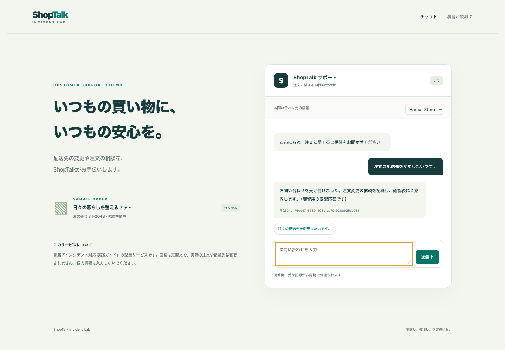
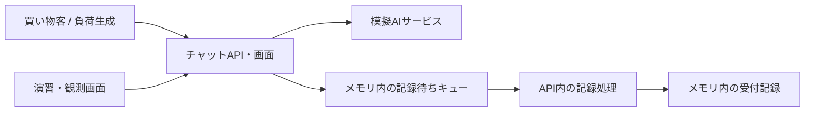

# ShopTalk Incident Lab

**判断し、復旧し、学び続ける。**

ECサイト向けAIチャットサポート「ShopTalk」を題材に、障害を起こし、影響を観測し、対処を選ぶための演習アプリケーションです。書籍『モダンシステム運用のためのインシデント対応 実践ガイド』の架空サービスを、手元のKubernetesで動かせます。

- 店舗ごとの問い合わせに応答するチャット画面
- テナント別の成功・失敗・待ち時間を確認する演習画面
- AI遅延、依存先の失敗、記録処理の停止を再現する4つのシナリオ
- リトライ回数、タイムアウト、同時受付数、縮退運転の変更
- Prometheus形式のメトリクスと、照会IDで追えるJSONログ

実際のAI API、クラウドアカウント、有料サービスは不要です。AIは遅延と失敗を制御できる定型応答サービスです。

## 画面



[演習・観測画面のスクリーンショット](docs/screenshots/lab.png)

## Kubernetesで起動する

必要なものはDocker、kind、kubectl、OpenSSLです。負荷生成と確認用スクリプトにはNode.js 24以上を使います。npmパッケージのインストールは不要です。

```bash
git clone https://github.com/ryuichi1208/shoptalk.git
cd shoptalk
bash scripts/kind-up.sh
```

このスクリプトはイメージをローカルでビルドし、専用のkindクラスタ `shoptalk` にロードします。クラスタ接続情報はこのディレクトリの `.kubeconfig` に保存し、通常のkubectlの接続先は変更しません。同名のkindクラスタがある場合は再利用します。別名にする場合は `CLUSTER_NAME=shoptalk-practice bash scripts/kind-up.sh` と指定してください。再実行するとPodが再起動し、演習データが初期化されます。

別のターミナルで接続を開きます。

```bash
kubectl --kubeconfig .kubeconfig -n shoptalk port-forward svc/shoptalk-api 8080:8080
```

- チャット画面：<http://localhost:8080>
- 演習・観測画面：<http://localhost:8080/lab>
- メトリクス：<http://localhost:8080/metrics>

演習画面のトークンは、次の方法で表示できます。トークンはクラスタ作成時に生成され、Gitには保存されません。

```bash
bash scripts/token.sh
```

同じディレクトリの別ターミナルで負荷をかけると、3店舗の違いを観察できます。

```bash
npm run load
# 60秒間、4並列で実行する場合
DURATION_SECONDS=60 CONCURRENCY=4 npm run load
```

負荷生成は閉ループ方式です。応答を待ってから次の要求を送るため、遅延時には到着率も下がります。一定到着率の負荷試験を再現するものではありません。

## 最初の演習

1. 正常状態で負荷をかけ、店舗別の応答と記録待ち件数を確認します。
2. 演習画面にトークンを入力し、「Harbor StoreだけAI応答が遅い」を適用します。
3. 全体の数値と店舗別の数値を比較します。誰に、どのような影響があるかを説明してください。
4. 再試行を減らす、タイムアウトを延ばす、縮退メッセージへ切り替えるなどの対処を選びます。
5. 対処の理由、観測した効果、利用者に残る制約を記録します。
6. 「正常設定へ戻す」を押し、新しい要求の成功と記録待ちの解消を確認します。

「正常設定へ戻す」は障害と対処の設定を初期値へ戻します。累計値と進行中の要求は消去しません。新しい演習をゼロから始めるには、負荷生成を止めた後に両方のDeploymentを再起動してください。

```bash
kubectl --kubeconfig .kubeconfig -n shoptalk rollout restart deployment/shoptalk-api deployment/shoptalk-ai
kubectl --kubeconfig .kubeconfig -n shoptalk rollout status deployment/shoptalk-api
kubectl --kubeconfig .kubeconfig -n shoptalk rollout status deployment/shoptalk-ai
```

詳しい手順、問い、期待される変化は [演習ガイド](docs/exercises.md) を参照してください。

## 構成



Kubernetes上にはAPIと模擬AIの2つのDeploymentを配置します。各Deploymentは1レプリカです。ServiceはClusterIPで、画面へはポートフォワードで接続します。

書籍の「チャット受付→AI応答→後続の注文記録」を簡略化しています。意図分類、外部注文管理システム、永続キュー、実モデルの品質評価は実装していません。チャット本文は保存せず、照会ID・店舗・受付時刻を記録します。実在の注文を変更する機能はありません。

詳しくは [設計と制約](docs/architecture.md)、[観測とAPI](docs/observability.md) を参照してください。

## Kubernetesを使わずに試す

Node.js 24以上で実行します。APIと模擬AIをそれぞれ127.0.0.1の8080・8081番ポートで起動します。演習用トークンは起動時に表示されます。

```bash
npm run dev
```

## 他のKubernetesクラスタに配置する

使用するクラスタを明示して作業してください。イメージは任意のレジストリへプッシュします。以下の `YOUR_REGISTRY` と `YOUR_CONTEXT` を自分の環境へ置き換えます。

```bash
docker build -t YOUR_REGISTRY/shoptalk:0.1.0 .
docker push YOUR_REGISTRY/shoptalk:0.1.0
kubectl --context YOUR_CONTEXT apply -f k8s/namespace.yaml
```

クラスタのCPUアーキテクチャに合わせてビルドしてください。複数アーキテクチャが必要な場合は、Docker Buildxなどで `linux/amd64` と `linux/arm64` 向けイメージを公開します。

Secretを作成します。以下はPOSIXシェル用です。トークンのファイルは作業後に削除します。

```bash
token_file="$(mktemp)"
chmod 600 "$token_file"
openssl rand -hex 24 | tr -d '\n' > "$token_file"
kubectl --context YOUR_CONTEXT -n shoptalk create secret generic shoptalk-lab --from-file="token=$token_file"
rm -f "$token_file"
```

`k8s/kustomization.yaml` に次の設定を加えてから適用します。非公開レジストリの場合はDeploymentの `imagePullSecrets` も設定してください。

```yaml
images:
  - name: shoptalk
    newName: YOUR_REGISTRY/shoptalk
    newTag: 0.1.0
```

```bash
kubectl --context YOUR_CONTEXT apply -k k8s
kubectl --context YOUR_CONTEXT -n shoptalk rollout status deployment/shoptalk-api
kubectl --context YOUR_CONTEXT -n shoptalk rollout status deployment/shoptalk-ai
kubectl --context YOUR_CONTEXT -n shoptalk port-forward svc/shoptalk-api 8080:8080
```

## 検証

```bash
npm test
```

HTTP通信を含むテストで、テナント別の遅延、再試行上限、縮退、受付制限、キューの再開、認証と入力検証を確認します。GitHub Actionsではコンテナをビルドし、kind上でも演習シナリオを確認します。

起動済みの専用演習環境で確認する場合は、ポートフォワード後に次を実行します。シナリオの設定を書き換えるため、他の演習と同時には実行しないでください。

```bash
LAB_TOKEN="$(bash scripts/token.sh)" npm run smoke
```

## 利用範囲

これはローカルまたは専用クラスタで使う演習アプリです。Kubernetesで動きますが、本番サービスの雛形ではありません。

- 設定、メトリクス、キュー、受付記録はメモリ内です。Pod再起動で失われます。
- APIの水平スケール、永続化、ログイン、実顧客の情報管理は対象外です。
- 設定変更にはトークンが必要です。画面、チャットAPI、観測データには利用者認証を設けていません。インターネットへ直接公開する構成は含めていません。
- Prometheus形式の出力は用意していますが、PrometheusやGrafana自体は同梱していません。

## 片付け

ポートフォワードと負荷生成を停止し、この演習で作成したkindクラスタを削除します。別名で作成した場合は、その名前を指定してください。

```bash
kind delete cluster --name shoptalk
```

## 書籍との対応

| 演習・機能 | 関連する節 |
| --- | --- |
| テナント別の影響確認、仮説と観測 | 3.1〜3.3 |
| 対処の理由、支援要請、次の判断時刻 | 4.1、5.3 |
| 演習の進行と振り返り | 11.2〜11.3 |
| AI遅延と後続処理の部分成功 | 13.1〜13.3 |
| リトライと依存先への負荷 | 14.1、16.2 |
| 縮退と通常運転への復帰 | 16.4、18.3 |

この実装の負荷や時刻は、書籍中の架空の数値を厳密に再現するものではありません。対応する挙動と判断を体験するための教材です。

## ライセンス

アプリケーションとこのリポジトリ内のドキュメントは [MIT License](LICENSE) です。書籍本文のライセンスとは別です。
